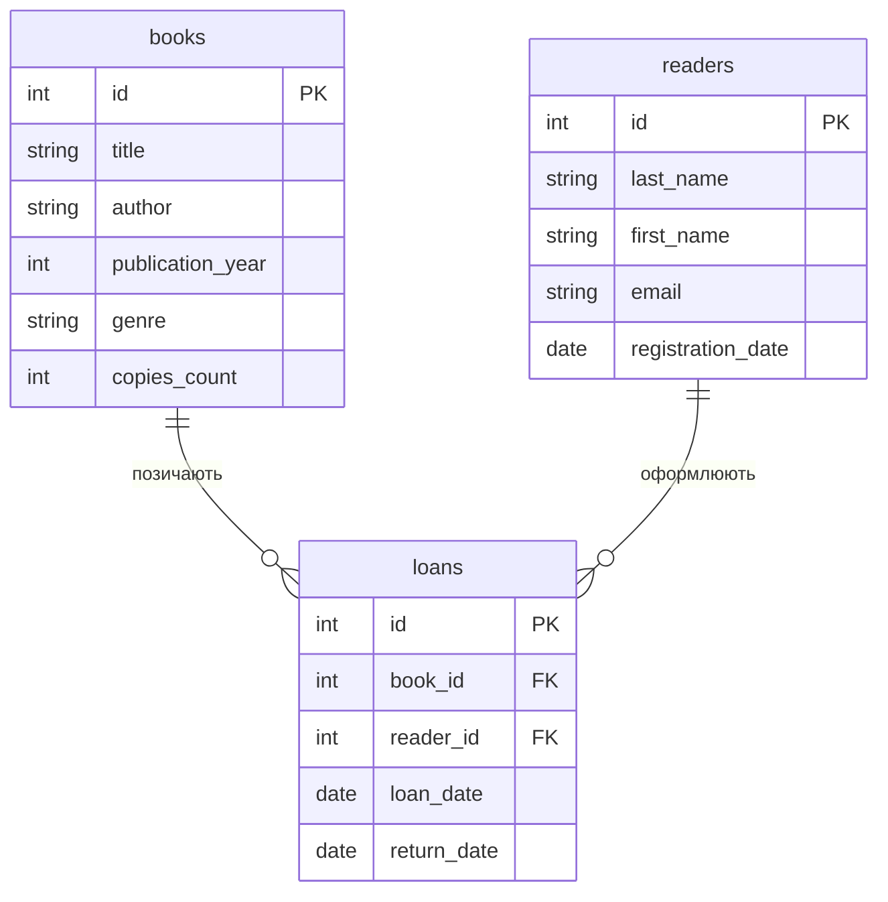

# Практична робота 3 — Створення ER-діаграми
## Варіант 1: Бібліотека

## Завдання 1. ER-діаграма повної схеми

## Завдання 2. Тип зв'язків

- **books — loans (1:N).** Одна книга може бути позичена багато разів у різні дати, тому в таблиці `loans` може бути багато записів із тим самим `book_id`. Кожен запис про позичання стосується однієї конкретної книги.
- **readers — loans (1:N).** Один читач може оформити багато позичань, тому в `loans` можуть бути кілька записів із тим самим `reader_id`. Кожне позичання оформлюється одним читачем.

## Завдання 3. Первинні й зовнішні ключі

- **books:** первинний ключ — `id`; зовнішніх ключів немає.
- **readers:** первинний ключ — `id`; зовнішніх ключів немає.
- **loans:** первинний ключ — `id`; зовнішні ключі:
  - `book_id` посилається на `books.id`.
  - `reader_id` посилається на `readers.id`.

## Завдання 4. Додавання ще однієї сутності

Можна додати таблицю `publishers` (видавництва), у якій зберігатимуться дані про видавництва: `id`, `name`, `city`. До таблиці `books` можна додати зовнішній ключ `publisher_id`, який посилатиметься на `publishers.id`. Зв'язок буде 1:N: одне видавництво може випустити багато книг, але кожна книга в цій моделі пов'язана з одним видавництвом.

## Завдання 5. Порівняння з прикладом хімчистки

Схема бібліотеки, як і схема хімчистки, складається з двох вимірних таблиць і однієї фактової таблиці, яка з'єднує їх за допомогою двох зовнішніх ключів. В обох схемах зв'язки між вимірними таблицями та фактовою таблицею мають тип 1:N. Вимірні таблиці не пов'язані напряму, а взаємодіють через фактову таблицю.

## Контрольні питання

**1. Чим логічна модель відрізняється від концептуальної, і чим фізична — від логічної?**  
Концептуальна модель описує предметну область на загальному рівні: які сутності існують і як вони пов'язані. Логічна модель деталізує сутності, атрибути, ключі та зв'язки. Фізична модель показує, як саме структура реалізується в конкретній СУБД, з урахуванням конкретних типів даних та інших особливостей.

**2. Чому зв'язок M:N не можна реалізувати двома зовнішніми ключами в одній із двох основних таблиць і завжди потрібна окрема таблиця?**  
У зв'язку M:N багато записів однієї таблиці можуть відповідати багатьом записам іншої. Два зовнішні ключі в одній із таблиць не можуть повноцінно зберігати всі такі комбінації без повторів або обмежень, тому створюють окрему проміжну таблицю, яка містить ключі обох таблиць.

**3. Що означають позначення ||, o{, |{ у синтаксисі mermaid erDiagram, і як прочитати A ||--o{ B?**  
`||` означає рівно один, `o{` — нуль або багато, а `|{` — один або багато. Запис `A ||--o{ B` читається так: кожен запис B пов'язаний рівно з одним A, а один запис A може бути пов'язаний із нулем або багатьма записами B.
